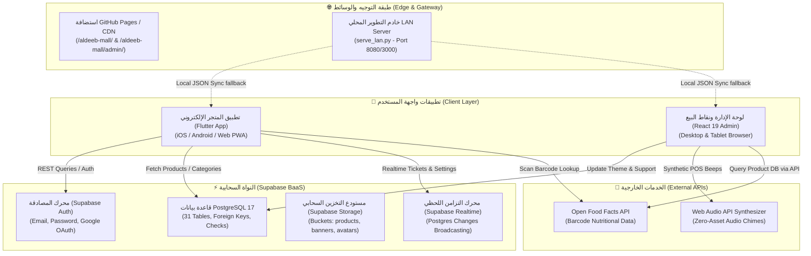

# 🛒 وثيقة التسليم التقني الشاملة لمنظومة الديب مول (Aldeeb Mall)
## ALDEEB MALL & HYPERMARKET — SYSTEM HANDOVER & ENGINEERING REFERENCE
**مرجع هندسي كامل مخصص لمهندس أو ذكاء اصطناعي يستلم المشروع لإكماله وصيانته ونشره للإنتاج**

---

## 1. ملخص المشروع والغرض الأساسي

### 1.1 ما هو المشروع؟
**الديب مول (Aldeeb Mall)** هو منظومة تجارة إلكترونية متكاملة للهايبرماركت ومتاجر التجزئة الكبرى (Omnichannel Hypermarket Ecosystem)، تم تصميمها بالهوية البصرية والتشغيلية المعتمدة لمنصات السوبرماركت العالمية (مثل كارفور وAmazon Fresh وNoon Minutes).
المنظومة تتكون من ثلاثة ركائز رئيسية:
1. **تطبيق العميل والمتجر الرقمي (`aldeeb_mall_app`)**: تطبيق متعدد المنصات (Multiplatform) مبني بإطار **Flutter** يعمل على الهواتف الذكية (iOS & Android) وعلى الويب (Web/PWA). يوفر تجربة شراء عربية فاخرة (RTL-First)، تصفحاً فائق السرعة للأقسام، بحثاً تفاعلياً وصوتياً وقارئ باركود، إدارة السلة الذكية، اختيار مواعيد التوصيل، قسائم الخصم، ونظام ولاء رقمي.
2. **لوحة التحكم وإدارة العمليات (`aldeeb_mall_admin`)**: لوحة تحكم إدارية مركزية مبنية بتقنية **React 19 + TypeScript + Vite + Tailwind CSS** لإدارة الكتالوج، المنتجات، الأقسام، العروض الترويجية، الطلبات الفورية، طواقم التوصيل، شاشات نقاط البيع (POS Terminal)، مصمم الفواتير الضريبية، ومراقبة المخزون.
3. **البنية السحابية وقاعدة البيانات (`supabase/`)**: قاعدة بيانات علائقية متقدمة **PostgreSQL 17** مستضافة على منصة **Supabase** مدعومة بسياسات أمان على مستوى الصفوف (Row-Level Security - RLS)، تريجرز ومحركات احتساب نقاط الولاء تلقائياً، والاشتراكات الحية (Supabase Realtime).

### 1.2 المشكلة التي يحلها ومن هم المستخدمون المستهدفون؟
- **المشكلة**: افتقار المتاجر التقليدية والهايبرماركت الإقليمية لمنظومة رقمية تجمع بين تجربة التسوق الرقمية السريعة (سلة مقاضي، أوزان بالكيلوغرام، منتجات طازجة ومبردة) مع نظام نقاط بيع (POS) كاشير وإدارة فرز وتوصيل متزامنة لحظياً، مما يؤدي إلى تضارب المخزون وضياع الطلبات.
- **المستخدمون المستهدفون**:
  1. **المستهلك النهائي (العميل)**: أفراد وعائلات يبحثون عن تسوق المقاضي اليومية والشهرية مع خيارات التوصيل الفوري (15-60 دقيقة) أو الاستلام من السيارة (Curbside Pickup).
  2. **طاقم المتجر وإدارة العمليات**: مديرو الفروع، عمال الفرز والتجهيز (Pickers)، ومندوبو التوصيل (Couriers).
  3. **الكاشير والمحاسبة**: موظفو نقاط البيع في فروع الهايبرماركت الفعلية لإصدار فواتير حرارية وإلكترونية.
  4. **الإدارة العليا ومسؤولو التسويق**: لمراقبة المؤشرات، تعديل هوية المتجر، وإطلاق الحملات والكوبونات.

---

## 2. جدول التقنيات والمكتبات المستخدمة (Tech Stack & Versions)

| المكون (Layer) | التقنية / الإطار | الإصدار الفعلي | وظيفتها الأساسية |
| :--- | :--- | :--- | :--- |
| **Client App (Frontend)** | **Flutter SDK** (Dart) | Flutter 3.x / Dart 3.11.5 | تطبيق العميل للهواتف والويب |
| **State Management** | **Provider** | `^6.1.5+1` | إدارة حالة التطبيق وسلة الشراء والطلبات |
| **Cloud Client (Mobile)** | `supabase_flutter` | `^2.18.3` | الاتصال بقاعدة بيانات Supabase والمصادقة |
| **Local Cache & Storage** | `shared_preferences` | `^2.5.6` | حفظ جلسة المستخدم والبيانات غير المتصلة |
| **Barcode Scanner** | `mobile_scanner` | `^7.5.0` | مسح الباركود عبر كاميرا الهاتف |
| **Voice Recognition** | `speech_to_text` | `^7.4.0` | المساعد الصوتي والبحث بالأوامر الصوتية |
| **Typography & Icons** | `google_fonts` / `lucide_icons` | `^8.2.1` / `^0.257.0` | خطوط تجوال وتصميم عصري للأيقونات |
| **Admin Control Tower** | **React** + **Vite** | React 19.0.0 / Vite 6.1.0 | لوحة التحكم الإدارية ونقاط البيع |
| **Admin Language** | **TypeScript** | `^5.7.3` | كتابة برمجية آمنة ومحددة الأنواع |
| **Admin Styling** | **Tailwind CSS** + PostCSS | `^3.4.17` | تنسيق مرن وسريع بنظام الأدوات المساعدة |
| **Admin Icons** | `lucide-react` | `^1.16.0` | حزمة أيقونات موحدة ومتجاوبة |
| **Cloud Backend & DB** | **Supabase (PostgreSQL 17)** | Cloud Hosted | قاعدة بيانات علائقية، RLS، ومصادقة |
| **Barcode/Nutrition API**| Open Food Facts REST API | v2 (HTTP) | جلب بيانات السلع والباركودات تلقائياً |
| **Audio Synthesizer** | Web Audio API (Native JS) | W3C Standard | توليد نغمات صوتية للطلبات والباركود برمجياً |
| **CI/CD Pipeline** | GitHub Actions | Ubuntu Latest | بناء ونشر تلقائي لـ GitHub Pages |
| **Local Server** | Python 3 Simple HTTP | Built-in | خادم تشغيل وتزامن محلي عبر الشبكة (`serve_lan.py`) |

---

## 3. خريطة المعمارية البرمجية وتدفق البيانات (System Architecture Map)



---

## 4. فهرس المسارات والملفات الحيوية في المشروع

### 4.1 تطبيق فلاتر (`aldeeb_mall_app/lib/`)
- [`lib/main.dart`](file:///Volumes/ssd/Projects/aldeeb_mall/aldeeb_mall_app/lib/main.dart): نقطة الدخول الرئيسية، تهيئة سوبابيز، حقن مديري الحالات (`MultiProvider`)، وتكوين مسارات التطبيق.
- [`lib/core/constants/supabase_constants.dart`](file:///Volumes/ssd/Projects/aldeeb_mall/aldeeb_mall_app/lib/core/constants/supabase_constants.dart): إعدادات الربط السحابي (URL و Anon Key) وأسماء الجداول ومجلدات التخزين.
- [`lib/core/services/supabase_service.dart`](file:///Volumes/ssd/Projects/aldeeb_mall/aldeeb_mall_app/lib/core/services/supabase_service.dart): طبقة استدعاءات البيانات (Categories, Products, Banners, Coupons, Orders) مع بيانات الاحتياط (Offline Defaults).
- [`lib/core/services/auth_service.dart`](file:///Volumes/ssd/Projects/aldeeb_mall/aldeeb_mall_app/lib/core/services/auth_service.dart): إدارة المصادقة، تسجيل الدخول بـ Google، والملفات الشخصية.
- [`lib/core/providers/cart_provider.dart`](file:///Volumes/ssd/Projects/aldeeb_mall/aldeeb_mall_app/lib/core/providers/cart_provider.dart): حسابات السلة المعقدة، تطبيق الكوبونات، ونقاط الولاء.
- [`lib/core/providers/mall_provider.dart`](file:///Volumes/ssd/Projects/aldeeb_mall/aldeeb_mall_app/lib/core/providers/mall_provider.dart): الكتالوج، التصنيفات، التصفية حسب الحميات، والترتيب.
- [`lib/core/providers/order_provider.dart`](file:///Volumes/ssd/Projects/aldeeb_mall/aldeeb_mall_app/lib/core/providers/order_provider.dart): إنشاء الطلبات وتتبع حالتها وإرسالها للسيرفر.
- [`lib/features/home/home_screen.dart`](file:///Volumes/ssd/Projects/aldeeb_mall/aldeeb_mall_app/lib/features/home/home_screen.dart): الصفحة الرئيسية الفاخرة للهايبرماركت (بانرات، أقسام، عروض حصرية، سلات سريعة).
- [`lib/features/checkout/checkout_screen.dart`](file:///Volumes/ssd/Projects/aldeeb_mall/aldeeb_mall_app/lib/features/checkout/checkout_screen.dart): معالج إتمام الطلب، اختيار خانات التوصيل، طرق الدفع، وملخص التكاليف.
- [`lib/features/scanner/barcode_scanner_screen.dart`](file:///Volumes/ssd/Projects/aldeeb_mall/aldeeb_mall_app/lib/features/scanner/barcode_scanner_screen.dart): ماسح الباركود الفعلي باستخدام الكاميرا.
- [`lib/features/customer_service/presentation/customer_service_screen.dart`](file:///Volumes/ssd/Projects/aldeeb_mall/aldeeb_mall_app/lib/features/customer_service/presentation/customer_service_screen.dart): مركز خدمة العملاء المباشر والشات التفاعلي.

### 4.2 لوحة الإدارة (`aldeeb_mall_admin/src/`)
- [`src/App.tsx`](file:///Volumes/ssd/Projects/aldeeb_mall/aldeeb_mall_admin/src/App.tsx): المكون الجذري الحاوي لحالة النظام بالكامل والتنقل بين الصفحات.
- [`src/lib/supabase.ts`](file:///Volumes/ssd/Projects/aldeeb_mall/aldeeb_mall_admin/src/lib/supabase.ts): إعداد عميل Supabase وتضمين مجموعات البيانات الأولية للهايبرماركت (`initialProducts`, `initialOrders`, إلخ).
- [`src/pages/OrdersPage.tsx`](file:///Volumes/ssd/Projects/aldeeb_mall/aldeeb_mall_admin/src/pages/OrdersPage.tsx): استعراض الطلبات وفلترتها وتعديل حالتها وطباعة فواتيرها.
- [`src/pages/ProductsPage.tsx`](file:///Volumes/ssd/Projects/aldeeb_mall/aldeeb_mall_admin/src/pages/ProductsPage.tsx): كتالوج السلع، الإضافة والتعديل والبحث الذكي وجلب الباركود.
- [`src/pages/PosTerminalPage.tsx`](file:///Volumes/ssd/Projects/aldeeb_mall/aldeeb_mall_admin/src/pages/PosTerminalPage.tsx): شاشة نقطة البيع السريعة للكاشير مع تعليق الفواتير وطباعة الإيصالات الحرارية.
- [`src/pages/SupportPage.tsx`](file:///Volumes/ssd/Projects/aldeeb_mall/aldeeb_mall_admin/src/pages/SupportPage.tsx): الرد الحي على استفسارات وتذاكر دعم العملاء الواردة من التطبيق.
- [`src/pages/SettingsPage.tsx`](file:///Volumes/ssd/Projects/aldeeb_mall/aldeeb_mall_admin/src/pages/SettingsPage.tsx): تخصيص مظهر المتجر والسمات والألوان والعملة وتكاليف التوصيل.
- [`src/pages/StaffManagementPage.tsx`](file:///Volumes/ssd/Projects/aldeeb_mall/aldeeb_mall_admin/src/pages/StaffManagementPage.tsx): إدارة طواقم العمل والمناوبات والصلاحيات.

### 4.3 قاعدة البيانات والنشر (`supabase/` & Root)
- [`supabase/MASTER_FULL_SCHEMA_DEPLOYMENT.sql`](file:///Volumes/ssd/Projects/aldeeb_mall/supabase/MASTER_FULL_SCHEMA_DEPLOYMENT.sql): ملف SQL الشامل المنشئ لـ 31 جدولاً مع القيود والفهارس.
- [`serve_lan.py`](file:///Volumes/ssd/Projects/aldeeb_mall/serve_lan.py): خادم HTTP بلغة بايثون للتشغيل المتزامن على الشبكة المحلية ومحاكاة الـ API.
- [`.github/workflows/deploy.yml`](file:///Volumes/ssd/Projects/aldeeb_mall/.github/workflows/deploy.yml): خط أنابيب النشر المؤتمت لـ GitHub Pages.

---

## 5. نظرة معمارية على قاعدة البيانات (Database Architecture)

### 5.1 الجداول الأساسية (Core Tables)
1. **`profiles`**: سجلات المستخدمين (الاسم، البريد، الهاتف، رصيد نقاط الولاء `loyalty_points`، الرتبة `membership_tier`).
2. **`categories`** و **`subcategories`**: الهيكل الشجري لتصنيفات الهايبرماركت مع الأيقونات وترتيب العرض.
3. **`products`**: كتالوج المنتجات متضمناً: الأسعار، التخفيضات، الباركود الدولي، الوزن، الصور، المخزون، وحزم المنتجات (Bundles).
4. **`banners`**: اللافتات الإعلانية وشاشات العروض وتحديد مسارات الانتقال عند النقر عليها.
5. **`coupons`**: رموز وقسائم الخصم ونسبها والحد الأدنى للطلب وتاريخ الصلاحية.
6. **`orders`** و **`order_items`**: سجل الطلبات، العناوين، طريقة الدفع، تفاصيل السلع المشتراة، وحالة الشحن.
7. **`support_tickets`**: تذاكر الدعم الفني، الرسائل المتزامنة، وحالة إغلاق التذكرة.
8. **`store_settings`**: إعدادات المتجر المتغيرة (الألوان، اسم المتجر، العملة، شريط الإعلانات).
9. **`staff_members`** و **`payroll_transactions`**: بيانات الموظفين، الرواتب، المناوبات، وصلاحيات الوصول.

---

## 6. تعليمات التشغيل السريع (Quickstart)

```bash
# 1. تشغيل لوحة الإدارة
cd aldeeb_mall_admin
npm install
npm run dev

# 2. تشغيل تطبيق فلاتر
cd aldeeb_mall_app
flutter pub get
flutter run -d chrome # أو على محاكي الهاتف
```
راجع التفاصيل الكاملة في ملف [`PROJECT_SETUP.md`](file:///Volumes/ssd/Projects/aldeeb_mall/PROJECT_SETUP.md).
