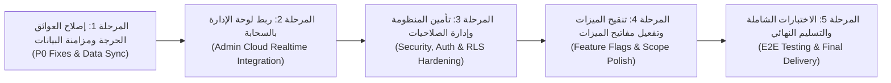

# 🗺️ خطة التنفيذ والتطوير لإكمال وتسليم مشروع الديب مول
## ALDEEB MALL & HYPERMARKET — ENGINEERING EXECUTION ROADMAP
**دليل المهام التفصيلي المتسلسل خطوة بخطوة للذكاء الاصطناعي أو المهندس المستلم حتى التسليم النهائي للعميل**

---

## 1. نظرة عامة على المراحل (Sprint Overview)



---

## 2. المهام التفصيلية لكل مرحلة

### المرحلة 1: إصلاح العوائق الحرجة ومزامنة البيانات (Sprint 1 - Critical Data Layer)
> **الهدف**: ضمان تسجيل الطلبات والبيانات الحقيقية في قاعدة بيانات Supabase بنجاح 100%.

#### المهمة 1.1: إصلاح قيد طرق الدفع في إنشاء الطلبات (`BUG-01`)
- **الملف المستهدف**: [`aldeeb_mall_app/lib/core/services/supabase_service.dart`](file:///Volumes/ssd/Projects/aldeeb_mall/aldeeb_mall_app/lib/core/services/supabase_service.dart) و [`checkout_screen.dart`](file:///Volumes/ssd/Projects/aldeeb_mall/aldeeb_mall_app/lib/features/checkout/checkout_screen.dart).
- **العمل المطلوب**:
  1. إضافة دالة تحويل في `SupabaseService`:
     ```dart
     String _mapPaymentMethod(String method) {
       final lower = method.toLowerCase();
       if (lower.contains('نقداً') || lower.contains('cod') || lower.contains('استلام')) return 'cod';
       if (lower.contains('محفظة') || lower.contains('نقاط') || lower.contains('loyalty')) return 'loyalty_points';
       if (lower.contains('apple')) return 'apple_pay';
       if (lower.contains('بطاقة عند الباب') || lower.contains('card_on_delivery')) return 'card_on_delivery';
       return 'card';
     }
     ```
  2. استخدام هذه القيمة عند إدراج السجل في جدول `orders`.
- **معايير القبول (Acceptance Criteria)**:
  - عند الضغط على "تأكيد الطلب" في تطبيق فلاتر، يتم إنشاء سجل حقيقي في جدول `public.orders` بـ Supabase بحالة `pending` ودون أي خطأ صامت في الـ Console.

#### المهمة 1.2: حفظ بنود الطلب في جدول `order_items` (`BUG-02`)
- **الملف المستهدف**: [`aldeeb_mall_app/lib/core/services/supabase_service.dart`](file:///Volumes/ssd/Projects/aldeeb_mall/aldeeb_mall_app/lib/core/services/supabase_service.dart).
- **العمل المطلوب**:
  1. تعديل `createOrder` لاستقبال قائمة `List<CartItemModel> items`.
  2. بعد إدراج الطلب في جدول `orders` واسترجاع `id` الخاص به، استدعاء:
     ```dart
     final orderId = orderResponse['id'];
     final itemsData = items.map((item) => {
       'order_id': orderId,
       'product_id': item.product.id,
       'quantity': item.quantity,
       'unit_price': item.product.price,
       'total_price': item.totalPrice,
     }).toList();
     await client!.from(SupabaseConstants.orderItemsTable).insert(itemsData);
     ```
- **معايير القبول**:
  - فحص جدول `public.order_items` في Supabase والتأكد من إدراج جميع السلع والكميات والأسعار المرتبطة برقم الطلب.

#### المهمة 1.3: توحيد معرفات المنتجات والأقسام (`BUG-04`)
- **الملفات المستهدفة**: [`aldeeb_mall_app/lib/core/services/supabase_service.dart`](file:///Volumes/ssd/Projects/aldeeb_mall/aldeeb_mall_app/lib/core/services/supabase_service.dart) و [`aldeeb_mall_admin/src/lib/supabase.ts`](file:///Volumes/ssd/Projects/aldeeb_mall/aldeeb_mall_admin/src/lib/supabase.ts).
- **العمل المطلوب**:
  1. تحديث قوائم `_defaultCategories` و `_defaultProducts` لتستخدم نفس الـ UUIDs المعتمدة في السحابة (`c0000000-0000-0000-0000-000000000001` إلخ).
- **معايير القبول**:
  - الفلترة حسب القسم تعمل بتطابق تام سواء كان التطبيق متصلاً بالسحابة أو يعمل ببيانات الاحتياط المحلية.

---

### المرحلة 2: ربط لوحة الإدارة بقاعدة البيانات السحابية (Sprint 2 - Admin Realtime Integration)
> **الهدف**: تحويل لوحة الإدارة من مجرد واجهة وهمية في ذاكرة المتصفح إلى غرفة عمليات تفاعلية حقيقية.

#### المهمة 2.1: ربط شاشة المنتجات (`ProductsPage.tsx`) بـ Supabase CRUD
- **الملف المستهدف**: [`aldeeb_mall_admin/src/pages/ProductsPage.tsx`](file:///Volumes/ssd/Projects/aldeeb_mall/aldeeb_mall_admin/src/pages/ProductsPage.tsx) و [`App.tsx`](file:///Volumes/ssd/Projects/aldeeb_mall/aldeeb_mall_admin/src/App.tsx).
- **العمل المطلوب**:
  1. إنشاء استعلام `fetchProducts` في `App.tsx` أو hook مخصص:
     ```typescript
     const { data } = await supabase.from('products').select('*').order('created_at', { ascending: false });
     if (data) setProducts(data);
     ```
  2. تعديل `handleAddProduct` لتنفيذ `await supabase.from('products').insert(newProduct)`.
  3. تعديل `handleUpdateProduct` لتنفيذ `await supabase.from('products').update(updatedProduct).eq('id', updatedProduct.id)`.
  4. تعديل `handleDeleteProduct` لتنفيذ `await supabase.from('products').delete().eq('id', productId)`.
- **معايير القبول**:
  - عند إضافة منتج جديد في لوحة الإدارة، يظهر فوراً في تطبيق الهاتف بعد السحب للتحديث (Pull to refresh).

#### المهمة 2.2: ربط شاشة الطلبات (`OrdersPage.tsx`) والاشتراك اللحظي في الطلبات الجديدة
- **الملف المستهدف**: [`aldeeb_mall_admin/src/pages/OrdersPage.tsx`](file:///Volumes/ssd/Projects/aldeeb_mall/aldeeb_mall_admin/src/pages/OrdersPage.tsx) و [`App.tsx`](file:///Volumes/ssd/Projects/aldeeb_mall/aldeeb_mall_admin/src/App.tsx).
- **العمل المطلوب**:
  1. جلب الطلبات الفعلية من جدول `public.orders` مع بنودها من `order_items`.
  2. تفعيل اشتراك لحظي (`Supabase Realtime Channel`):
     ```typescript
     const channel = supabase.channel('realtime_orders')
       .on('postgres_changes', { event: 'INSERT', schema: 'public', table: 'orders' }, payload => {
         setOrders(prev => [payload.new as Order, ...prev]);
         playOrderChime(); // إطلاق النغمة الصوتية المنبهة فوراً
       })
       .subscribe();
     ```
  3. تحديث حالة الطلب (`onUpdateOrderStatus`) ليقوم بـ `await supabase.from('orders').update({ status }).eq('id', orderId)`.
- **معايير القبول**:
  - بمجرد قيام العميل بالطلب من تطبيق فلاتر، يظهر الطلب في شاشة الطلبات بلوحة الإدارة خلال ثانيتين مع صدور صوت التنبيه.

---

### المرحلة 3: تأمين المنظومة وإدارة الصلاحيات (Sprint 3 - Security & Access Control)
> **الهدف**: حماية لوحة الإدارة من الوصول غير المصرح به وضبط صلاحيات الوصول في قاعدة البيانات.

#### المهمة 3.1: إنشاء شاشة تسجيل دخول للوحة الإدارة (Admin Auth Guard)
- **الملف المستهدف**: [`aldeeb_mall_admin/src/App.tsx`](file:///Volumes/ssd/Projects/aldeeb_mall/aldeeb_mall_admin/src/App.tsx).
- **العمل المطلوب**:
  1. إنشاء نموذج تسجيل دخول إداري يطلب البريد الإلكتروني وكلمة المرور.
  2. التحقق من حساب المستخدم عبر `supabase.auth.signInWithPassword` والتأكد من وجود صف له في جدول `staff_members` برتبة مسموح بها (`manager`, `admin`, `cashier`).
  3. حظر الوصول لصفحات الرواتب والإعدادات إذا لم يكن المستخدم مديراً (`super_admin` أو `general_manager`).
- **معايير القبول**:
  - لا يمكن تصفح لوحة التحكم أو نقاط البيع إلا بعد تسجيل الدخول بنجاح.

#### المهمة 3.2: تعديل سياسات الأمان RLS لدعم الطلب كزائر (Guest Checkout Support)
- **الملف المستهدف**: [`supabase/migrations/20261031_002_rls_security.sql`](file:///Volumes/ssd/Projects/aldeeb_mall/supabase/migrations/20261031_002_rls_security.sql).
- **العمل المطلوب**:
  1. السماح بإدراج الطلبات التي لا تحتوي على `user_id` (أو ربطها بمستخدم مجهول متاح للعامة).
- **معايير القبول**:
  - العميل غير المسجل دخول يستطيع إتمام الشراء دون أن ترفض قاعدة البيانات طلبه.

---

### المرحلة 4: تنقيح الميزات وتفعيل مفاتيح الميزات (Sprint 4 - Feature Flags & Scope Polish)
> **الهدف**: فرز الميزات الجاهزة للإطلاق عن ميزات المحاكاة التجريبية وتقديم تجربة متناسقة للعميل.

#### المهمة 4.1: إدارة ظهور الميزات التجريبية عبر مفاتيح التحكم (`Feature Flags`)
- **الملف المستهدف**: [`aldeeb_mall_admin/src/lib/featureFlags.ts`](file:///Volumes/ssd/Projects/aldeeb_mall/aldeeb_mall_admin/src/lib/featureFlags.ts) و [`store_settings_provider.dart`](file:///Volumes/ssd/Projects/aldeeb_mall/aldeeb_mall_app/lib/core/providers/store_settings_provider.dart).
- **العمل المطلوب**:
  1. حجب شاشات (عربات الـ IoT، الطائرات المسيرة، الصيدلية، البث المباشر) عن القائمة العامة للتطبيق في الإصدار الأول (v1.0)، ووضع مفتاح تحكم يتيح تفعيلها عند الرغبة في عرضها كـ Demo تقني فقط.
- **معايير القبول**:
  - الواجهة التي يراها العميل خالية تماماً من أي شاشات تحتوي على بيانات وهمية أو أزرار غير فعالة.

---

### المرحلة 5: الاختبارات الشاملة وتجهيز التسليم النهائي (Sprint 5 - E2E Testing & Release)
> **الهدف**: التحقق النهائي من استقرار المشروع وإعداده للتسليم للعميل في بيئة الإنتاج.

#### المهمة 5.1: اختبار رحلة المستخدم الكاملة من البداية للنهاية (End-to-End User Journey)
1. تشغيل التطبيق واختيار سلع من تصنيفات مختلفة (فواكه بالكيلو، مياه بالكرتونة).
2. تطبيق كود الخصم `ALDEEB10` والتأكد من خصم النسبة والحد الأقصى بدقة.
3. اختيار خانة التوصيل وطريقة الدفع وإرسال الطلب.
4. التأكد من استقبال لوحة الإدارة للطلب وإصدار النغمة الصوتية.
5. فتح الطلب وطباعة إيصال الفاتورة الحرارية.
6. تحديث حالة الطلب إلى "مع مندوب التوصيل" والتحقق من انعكاس الحالة فوراً في شاشة تتبع الطلب بهاتف العميل.

#### المهمة 5.2: إجراء مراجعة جاهزية الإنتاج (Production Checklist Sign-Off)
- فحص جميع الروابط، الصور، استجابة الشاشات على مقاسات الهواتف المختلفة، وتحديث ملفات التوثيق.
